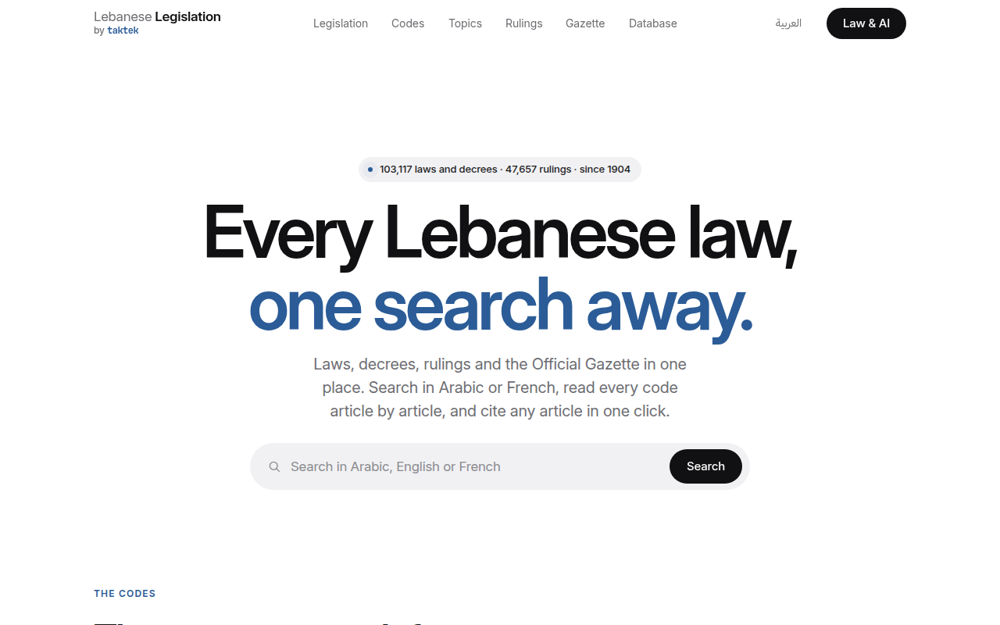

<p align="center">
  <a href="https://lebaneselegislation.com/"></a>
</p>

<h1 align="center">Lebanese Legislation</h1>

<p align="center">
  <b>Every Lebanese law, as open tables.</b><br>
  Laws, decrees, court rulings and the Official Gazette from 1904 to today, in Arabic and French, with the links between them. The dataset behind <a href="https://lebaneselegislation.com/">LebaneseLegislation.com</a>.
</p>

<p align="center" dir="rtl">
  التشريع اللبناني: القوانين والمراسيم والقرارات مع موادها، والأحكام القضائية، وأعداد الجريدة الرسمية، والروابط بين النصوص (التعديل والإلغاء والإحالة)، بالعربية والفرنسية، كجداول Parquet مفتوحة.
</p>

<p align="center">
  <a style="display: inline-block;" href="https://lebaneselegislation.com/laws/"></a>
  <a style="display: inline-block;" href="https://lebaneselegislation.com/laws/"></a>
  <a style="display: inline-block;" href="https://lebaneselegislation.com/rulings/"></a>
  <a style="display: inline-block;" href="https://huggingface.co/datasets/taktekhq/lebanese-legislation/commits/main"></a>
  <a style="display: inline-block;" href="https://lebaneselegislation.com/ai/"></a>
  <a style="display: inline-block;" href="https://github.com/taktekhq/lebanese-legislation"></a>
</p>

<p align="center">
  <a href="https://lebaneselegislation.com/">Website</a> ·
  <a href="https://lebaneselegislation.com/ai/">AI and MCP</a> ·
  <a href="https://lebaneselegislation.com/developers/">API</a> ·
  <a href="https://github.com/taktekhq/lebanese-legislation">Code on GitHub</a> ·
  <a href="https://lebaneselegislation.com/blog/">Journal</a> ·
  <a href="#students-get-paid-to-study-with-it">Students</a>
</p>

<p align="center">
  <a href="https://lebaneselegislation.com/"></a>
</p>

## Why

The texts of Lebanese law are public, but hard to use. Here every law, decree, ruling and Gazette issue is a row, every article is linked to the texts that amend it and the rulings that apply it, and every row points back to its source at the Lebanese University's Centre for Research and Studies in Legal Informatics. Use it to search texts, follow amendments or build legal research tools.

On 5 November 2026 it held 103,114 laws, decrees and decisions, 389,078 articles, 47,657 court rulings, 6,851 Gazette issues and 367,807 links between texts. The badges above show today's counts.

## Start in one minute

**Load a table** with `datasets`. Each table is a subset:

```python
from datasets import load_dataset

articles = load_dataset("taktekhq/lebanese-legislation", "legislation_article", split="train")
```

**Query it in place** with DuckDB, without downloading the whole dataset:

```sql
SELECT kind, count(*) AS texts, min(issued_on) AS first, max(issued_on) AS last
FROM 'hf://datasets/taktekhq/lebanese-legislation/data/legislation.parquet'
GROUP BY kind ORDER BY texts DESC LIMIT 5;
```

**Connect your AI assistant.** The MCP server is free, needs no key, and returns the texts word for word:

```sh
claude mcp add --transport http lebanese-legislation https://lebaneselegislation.com/mcp
```

Claude, ChatGPT, Cursor and Gemini setup: [lebaneselegislation.com/ai](https://lebaneselegislation.com/ai/).

**Call the API.** No key, JSON, described by [`/openapi.json`](https://lebaneselegislation.com/openapi.json):

```sh
curl -G 'https://lebaneselegislation.com/api/v1/search/' --data-urlencode 'q=قانون العمل'
```

**Get it as PostgreSQL.** `ghcr.io/taktekhq/lebanese-legislation-db:latest` has the databases baked from the same tables. `ghcr.io/taktekhq/lebanese-legislation-all:latest` adds the website, API and MCP server. See [run the services locally](https://github.com/taktekhq/lebanese-legislation#run-the-services-locally).

## What is in it

One Parquet file per table in `data/`, 30 in all. The main ones:

| Subset | One row is |
| --- | --- |
| `legislation` | A law, decree, decision or other text: kind, number, dates, title, status, Gazette details, and an unofficial English title |
| `legislation_article` | An article, in Arabic (and French where published), with the Centre's notes |
| `article_in_force` | An article's state today: in force or repealed, and the wording in force when it differs |
| `amendment` | A change one text made to another |
| `graph_edge` | A link between two items: amends, repeals, cites, applies, publishes |
| `ruling` | A court ruling: court, number, date, panel, text |
| `ruling_page` | One page of a scanned judgment, read by machine |
| `gazette_issue` | An Official Gazette issue |
| `gazette_entry` | A text published in a Gazette issue |
| `legislation_scan` | A text read from Gazette scans that the Centre has not published yet |

Every table, column and join, with more load examples: [SCHEMA.md](SCHEMA.md). How each was built: [METHODS.md](METHODS.md).

## Where everything is

| You want | Go to |
| --- | --- |
| Read the laws | [LebaneseLegislation.com](https://lebaneselegislation.com/) |
| Connect an AI assistant | The free MCP server at `https://lebaneselegislation.com/mcp`. [Setup](https://lebaneselegislation.com/ai/) |
| The data as tables | This dataset |
| The data as a PostgreSQL database | The [`-db` or `-all` image](https://github.com/taktekhq/lebanese-legislation#images) |
| Semantic search vectors | [`vectors/vectors.parquet`](#vectors) in this dataset |
| The original court scans | [Lebanese Court Scans](https://huggingface.co/datasets/taktekhq/lebanese-court-scans) |
| Every source page as it was served | [The archive dataset](https://huggingface.co/datasets/taktekhq/lebanese-legislation-archive) |
| The code, Docker images and data history | [github.com/taktekhq/lebanese-legislation](https://github.com/taktekhq/lebanese-legislation) |
| What changed and why | The [project journal](https://lebaneselegislation.com/blog/) |
| Everything in one place | The [collection](https://huggingface.co/collections/taktekhq/lebanese-legislation), with the [handwriting demo](https://huggingface.co/spaces/taktekhq/lebanese-legal-handwriting) |

[Dactelo](https://dactelo.com/) is the related Arabic handwriting project.

## What to check

Most source texts come from the [Centre for Research and Studies in Legal Informatics, Lebanese University](https://legallaw.ul.edu.lb/). Please credit the Centre when reusing them. This is an independent, unofficial dataset, without state or University endorsement. The licence is `other`; we add no rights or restrictions over source documents. Code licensing does not replace this dataset's source rights and attribution.

Source text, machine readings and editorial corrections have different provenance. English titles are machine-generated search aids. Judgment transcriptions and recent Gazette readings may contain errors. They are not reviewed ground truth. Check the original PDF (the judgment scans, or the Gazette PDF on SaderLex that each scanned text links) and the authoritative publication before relying on them. Derived amendment links and in-force states also need checking. See [METHODS.md](METHODS.md) for uncertainty markers, corrections, provenance and citation.

Individual tables can be incomplete. Judgment reading is still under way. This dataset is not legal advice. Send corrections to nizar@taktek.io.

## How it is updated

The tables are rebuilt and published from the [public repository](https://github.com/taktekhq/lebanese-legislation) when the source data changes; the commit and date of each upload are in this dataset's history. The update itself is public: [`scripts/nightly.sh`](https://github.com/taktekhq/lebanese-legislation/blob/main/docs/update-data.md) rebuilds the tables and opens a pull request, and the upload follows its merge.

The [JSON API](https://lebaneselegislation.com/developers/) and [MCP server](https://lebaneselegislation.com/ai/) serve the same data, free and without a key, under the site's [terms of use](https://lebaneselegislation.com/en/terms/).

## Calculated monetary amounts

`article_calculated_current.parquet` is an optional derived sidecar. It contains
`law_id` (integer), `number` (text), `position` (integer), `source_sha256` (text)
and `calculated_current` (JSON text). Join on law, article number and position,
then verify the source text and its SHA-256 against `article_in_force`.

The object contains the calculated Arabic article, its exact published input,
input hash, multiplier, and authority. `is_published_wording` is false. Use this
object for current monetary amounts when present and identify the result as
calculated under decree 13909/2024, article 1, effective 2024-09-19. It covers only
the 34 reviewed Civil Procedure articles (law 244565), including 56 monetary
occurrences. All original texts and versions retain their published wording.
Other laws, changed sources, repealed or annulled articles, and pending or future
wording receive no record. Older dataset snapshots may omit this file.

## Vectors

[`vectors/vectors.parquet`](https://huggingface.co/datasets/taktekhq/lebanese-legislation/resolve/main/vectors/vectors.parquet) contains every semantic search chunk,
embedded with `gemini-embedding-001` in 768 dimensions. Columns: `id`,
`document`, `model`, `hash`, `values` (`FLOAT[768]`).

Read it directly with DuckDB:

```sql
SELECT id, document, model, hash, values
FROM read_parquet('https://huggingface.co/datasets/taktekhq/lebanese-legislation/resolve/main/vectors/vectors.parquet')
LIMIT 5;
```

The hosted search uses Cloudflare Vectorize index `lebleg-chunks` instead of
storing vectors in PostgreSQL. The [vectors workflow](https://github.com/taktekhq/lebanese-legislation/blob/main/.github/workflows/vectors.yml)
runs `build`, then `publish` and `vectorize`. `cmd/export-vectors` exports the
chunks; `cmd/embed-missing` embeds new chunks under a daily budget ($1, 20,000
chunks), and nothing is published while a current chunk has no vector;
`cmd/vectorize-sync` uploads only changed vectors on later runs.

## Students: get paid to study with it

Studying law or political science at a Lebanese university? We pay current students to study with the site and tell us what to fix, instead of spending on ads: [the student program](https://lebaneselegislation.com/contribute/#students).

## Citation

Credit the Centre for the texts, and cite the dataset as:

```bibtex
@dataset{lebanese_legislation,
  title        = {Lebanese Legislation: the relational database of Lebanese law},
  author       = {{Taktek, LLC}},
  year         = {2026},
  url          = {https://huggingface.co/datasets/taktekhq/lebanese-legislation},
  note         = {Texts: Centre for Research and Studies in Legal Informatics, Lebanese University}
}
```

To cite one law or article, use its address on [lebaneselegislation.com](https://lebaneselegislation.com): `/law/<id>/` and `/law/<id>/article/<n>/` do not change.
