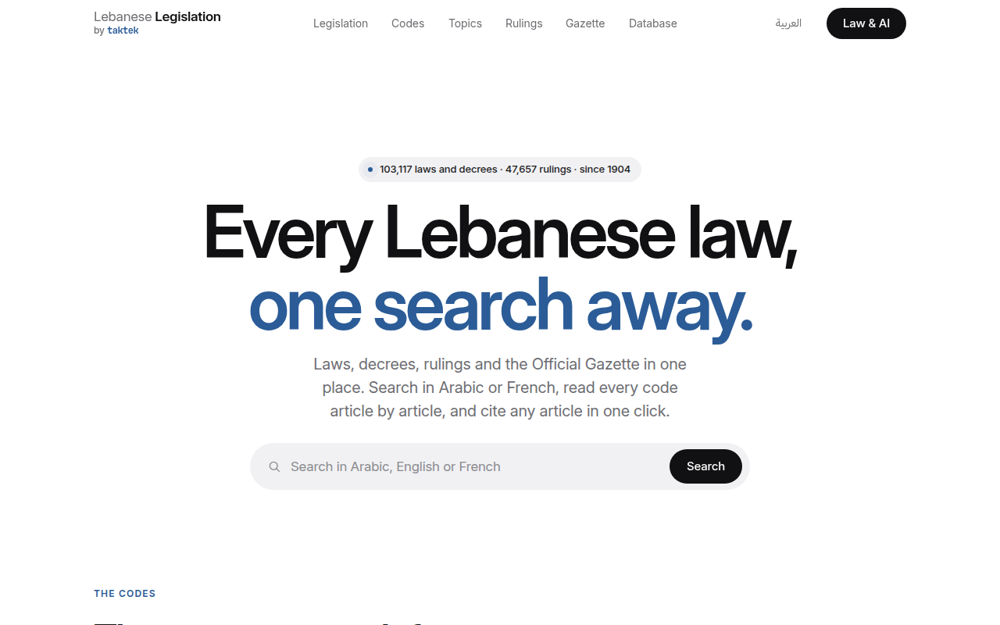
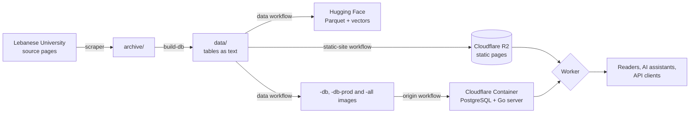

<p align="center">
  <a href="https://lebaneselegislation.com/"></a>
</p>

<h1 align="center">Lebanese Legislation</h1>

<p align="center">
  <b>Every Lebanese law, one search away.</b><br>
  The open code and data behind <a href="https://lebaneselegislation.com/">LebaneseLegislation.com</a>: laws, decrees, court rulings and the Official Gazette, in Arabic and French, with search, a JSON API and an MCP server for AI assistants.
</p>

<p align="center" dir="rtl">
  التشريع اللبناني: القوانين والمراسيم والأحكام القضائية والجريدة الرسمية، بالعربية والفرنسية، كبيانات مفتوحة وواجهة برمجية وخادم MCP لمساعدي الذكاء الاصطناعي.
</p>

<p align="center">
  <a href="https://lebaneselegislation.com/laws/"></a>
  <a href="https://lebaneselegislation.com/laws/"></a>
  <a href="https://lebaneselegislation.com/rulings/"></a>
  <a href="https://huggingface.co/datasets/taktekhq/lebanese-legislation"></a>
  <a href="https://huggingface.co/datasets/taktekhq/lebanese-legislation"></a>
  <a href="https://lebaneselegislation.com/ai/"></a>
</p>

<p align="center">
  <a href="https://github.com/taktekhq/lebanese-legislation/actions/workflows/checks.yml"></a>
  <a href="https://github.com/taktekhq/lebanese-legislation/releases"></a>
  <a href="go.mod"></a>
  <a href="LICENSE"></a>
  <a href="https://github.com/taktekhq/lebanese-legislation/stargazers"></a>
</p>

<p align="center">
  <a href="https://lebaneselegislation.com/">Website</a> ·
  <a href="https://lebaneselegislation.com/ai/">AI and MCP</a> ·
  <a href="https://lebaneselegislation.com/developers/">API</a> ·
  <a href="https://huggingface.co/taktekhq">Data on Hugging Face</a> ·
  <a href="https://lebaneselegislation.com/blog/">Journal</a> ·
  <a href="#students-get-paid-to-study-with-it">Students</a>
</p>

<p align="center">
  <a href="https://lebaneselegislation.com/"></a>
</p>

## Why

The texts of Lebanese law are public, but hard to read online. LebaneseLegislation.com puts every law, decree, ruling and Gazette issue on its own page, links each article to the texts that amend it and the rulings that apply it, and gives developers and AI assistants the same data through an API, an MCP server and open downloads. Every page links back to its source at the Lebanese University's Centre for Research and Studies in Legal Informatics.

## Start in one minute

**Read and search** at [lebaneselegislation.com](https://lebaneselegislation.com/). Questions get a short answer written only from the library's own texts, with a link to each source.

**Connect your AI assistant.** The MCP server is free, needs no key, and returns the texts word for word:

```sh
claude mcp add --transport http lebanese-legislation https://lebaneselegislation.com/mcp
```

Claude, ChatGPT, Cursor and Gemini setup: [lebaneselegislation.com/ai](https://lebaneselegislation.com/ai/) and [docs/mcp.md](docs/mcp.md).

**Call the API.** No key, JSON, described by [`/openapi.json`](https://lebaneselegislation.com/openapi.json):

```sh
curl -G 'https://lebaneselegislation.com/api/v1/search/' --data-urlencode 'q=قانون العمل'
```

**Load the data.** One Parquet file per table on Hugging Face:

```python
from datasets import load_dataset
articles = load_dataset("taktekhq/lebanese-legislation", "legislation_article", split="train")
```

**Run the whole site yourself.** One image holds the database, the website, the API and the MCP server:

```sh
git clone https://github.com/taktekhq/lebanese-legislation.git && cd lebanese-legislation
./setup && docker compose --profile all up -d all   # then open http://localhost:8080
```

## Where everything is

| You want | Go to |
| --- | --- |
| Read the laws | [LebaneseLegislation.com](https://lebaneselegislation.com/) |
| Connect an AI assistant | The free MCP server at `https://lebaneselegislation.com/mcp`. [Setup](docs/mcp.md) |
| The data as tables | [Parquet files on Hugging Face](https://huggingface.co/datasets/taktekhq/lebanese-legislation) |
| The data as a PostgreSQL database | The [`-db` or `-all` image](#images), with the databases baked from `data/` |
| Semantic search vectors | [vectors/vectors.parquet](https://huggingface.co/datasets/taktekhq/lebanese-legislation/resolve/main/vectors/vectors.parquet), embedded with `gemini-embedding-001` in 768 dimensions. [Read with DuckDB](docs/reference.md#vectors) |
| The original court scans | [Court scans on Hugging Face](https://huggingface.co/datasets/taktekhq/lebanese-court-scans) |
| Every source page as it was served | [Archive dataset on Hugging Face](https://huggingface.co/datasets/taktekhq/lebanese-legislation-archive) and [its repository](https://github.com/taktekhq/lebanese-legislation-archive) |
| What changed and why | The [project journal](https://lebaneselegislation.com/blog/) and [docs/changes.md](docs/changes.md) |
| Get paid to study with it (students in Lebanon) | [The student program](#students-get-paid-to-study-with-it) |

Data lives on Hugging Face. Code and Docker images live here. Each GitHub release is a code version, never a data download.

## How it runs



Cloudflare serves the static pages and ruling PDFs from R2 through the Worker in [`workers/static-site`](workers/static-site/). Search, `/api/v1/`, filters, scans and `/mcp` go through `workers/origin` to a blue/green Cloudflare Container running the `-all` image. [static-site.yml](.github/workflows/static-site.yml) renders `data/` with `cmd/static-export`, only the pages that changed: a data change renders the pages its rows touch, a template, string or topic guide change the pages that used it, and a Go change every page. It starts on every push to main that touches the site, and a catch-up check after each deploy reruns a failed one. Changed pages go to IndexNow. [vectors.yml](.github/workflows/vectors.yml) embeds new passages, publishes the vectors and loads Cloudflare Vectorize. See [architecture](docs/architecture.md) and [static export](docs/static-export.md).

**Fast because the work is done at build time.** The served database is read-only, so anything that is the same for every caller is computed once, when the image is built: law and article cards, ordered amendment lists, running counts for list totals, and the word lists search ranks from. On 9 November 2026 real `get_article` calls went from a p95 of 1,060 ms to 131 ms on the same one-CPU container, with byte-identical replies. No cache, no warm-up. See [how the build makes reads fast](docs/performance.md).

AI crawlers are welcome. `robots.txt` lets every named AI crawler (GPTBot, ClaudeBot, PerplexityBot, ShapBot and others) read the pages, search, the API and the MCP server. Every client gets the same limit on dynamic paths: 30 requests per 10 seconds from one address.

Agents find the API and the MCP server by themselves: every page carries `Link` headers, every static page answers `Accept: text/markdown` with Markdown, and `/.well-known/` holds the API catalog, the MCP server card, an A2A agent card and an agent skill. See [what AI agents find here](docs/agents.md).

## Update the data yourself

Run `scripts/nightly.sh` on your own machine to scrape, rebuild, check and
export the data, then open a data-only pull request. Use `--dry-run` to do the
work locally without pushing or opening a PR. GitHub Actions cannot run it.

You need Bash, flock, Git, rsync, curl, Python 3, Go, PostgreSQL and an
authenticated GitHub CLI. Set `LEBLEG_DSN` to a dedicated rebuild database;
`LEBLEG_STORE`, `LEBLEG_DATA` and `LEBLEG_LOCK_FILE` override local paths.
`LEBLEG_REPO` selects the target repository. Maintainers merge the PR, then
the workflows publish everything. See [Update the data](docs/update-data.md)
for requirements, every step, configuration and a nightly user systemd timer.

## Production and development

The same image, `ghcr.io/taktekhq/lebanese-legislation-all`, runs in both. It holds PostgreSQL with the data, the API (`/api/v1/`), the MCP server (`/mcp`) and the website server.

| | Production | Development |
|---|---|---|
| Static pages | built by `static-site.yml` into Cloudflare R2, served by the Worker in `workers/static-site` | rendered on request by the `-all` image |
| API, MCP, search | the Worker passes them to `-all` (Cloudflare Containers, blue/green, `workers/origin`) | `-all` directly |
| Run it | `origin.yml` deploys it | `docker compose --profile all up all`, then open http://localhost:8080 |

To check that production serves the latest main (pages, API, MCP and the `/healthz` build), run [livecheck](https://github.com/taktekhq/livecheck) in the repository root; it reads [`livecheck.yaml`](livecheck.yaml).

In development every page is rendered on request, which is slower than production but needs nothing besides the image. To get the exact static copy production serves, run `static-export` against the database: see [docs/static-export.md](docs/static-export.md).

## Run the services locally

```sh
git clone https://github.com/taktekhq/lebanese-legislation.git
cd lebanese-legislation
./setup
docker compose --profile all up -d all
```

You need Docker Compose, 8 GB of free memory and 30 GB of free disk. `./setup` writes private local passwords to `.env`. The image already holds both databases. The first start copies them into an empty volume; later starts reuse it.

Then open the website at http://localhost:8080, the API at http://localhost:8080/api/v1/, or point an MCP client at http://localhost:8080/mcp.

To run the database, API and MCP as separate services instead, use `docker compose up -d --wait db api mcp`: the API answers on http://localhost:8000/api/v1/ and MCP on http://localhost:8001/mcp. Every image is pulled as `:latest`, so a `docker compose pull` is all an update needs. Exact and citation search need no AI key. For search by meaning, configure your own Gemini key and Vectorize index, or load the public vectors into pgvector in `lebleg_search`. See [loading vectors](vectors/README.md).

## Images

All names use the prefix `ghcr.io/taktekhq/lebanese-legislation`.

| Image | Holds | Used by |
| --- | --- | --- |
| `-db` | PostgreSQL 18.6, pgvector, both databases baked from `data/`, chunk text and hashes without embeddings | Compose, database users and the static render |
| `-db-prod` | `-db` plus read-optimized tables computed from it at build time ([`db/prod.sql`](db/prod.sql)); no new data | The base of `-all` |
| `-api` | Standalone API server, unchanged Dockerfile and amd64/arm64 support | Compose and API users with a separate database |
| `-mcp` | Standalone MCP server, unchanged Dockerfile and amd64/arm64 support | Compose and MCP clients with a separate database |
| `-all` | `-db-prod` plus the Go server for dynamic pages, `/api/v1/`, `/mcp` and badges, and the search word lists | Compose, Cloudflare Containers and self-hosted sites |
| `-vectors` | `vectorize-sync`, `export-vectors` and DuckDB; downloads the Hugging Face vectors at runtime | The vectors workflow and users loading Vectorize or pgvector |

Each image is built by the workflow that produces its inputs: the
[checks](.github/workflows/checks.yml) workflow publishes `-api`, `-mcp` and
`-all` after a push to main, [data](.github/workflows/data.yml) publishes `-db`,
`-db-prod` and `-all` after a data change, and [vectors](.github/workflows/vectors.yml)
publishes `-vectors`. [images.yml](.github/workflows/images.yml) is a manual
button to rebuild one. Every image gets a `latest` tag and a UTC date tag, so
use `:latest` unless you need a fixed copy. Static pages are published directly to R2.
Publishing of `-web` and `-data` has stopped; existing registry packages remain.
Compose pulls `ghcr.io/taktekhq/lebanese-legislation-all:latest` for the website, including its database, API and MCP.

API and MCP candidates are smoke-tested on both architectures before promotion;
existing immutable release versions are retained and new versions are added when free.

[Service reference](docs/reference.md): configuration and using your own PostgreSQL.

## What is in this repository

| Folder | What it is |
| --- | --- |
| [`data/`](data/) | The database as text: one folder per table, rows sorted by key, so `git log -p` shows what changed. `data/load.sh` builds it in PostgreSQL. |
| [`archive/`](https://github.com/taktekhq/lebanese-legislation-archive) | Every source page as the Centre's site served it, with its change history: [its own repository](https://github.com/taktekhq/lebanese-legislation-archive), mounted here as a submodule. A plain clone skips it; `git submodule update --init archive` fetches them. |
| [`db/`](db/) | The database's schema and the build's curated inputs (the Go package `db`), and the PostgreSQL image, built with pgvector on the official `postgres:18.6` image. |
| [`web/`](web/) | The website: its `main.go`, test-only Dockerfile, SQL schema and a fictional test database. |
| [`api/`](api/) | The REST API: its `main.go` and Dockerfile. |
| [`mcp/`](mcp/) | The MCP server: its `main.go` and Dockerfile. |
| [`internal/`](internal/) | The Go code: what the three services share (pages, API, MCP tools, search) and the build that makes the database from the source pages (`internal/build`, with parsing, amendments, citations, the wording guard in `internal/provenance`, and the export). |
| [`scraper/`](scraper/) | The crawler that reads the Lebanese University's site into the archive, and the scripts that publish the archive. |
| [`cmd/`](cmd/) | One command per job: build the database, model readings, data checks, export, and local services. [Listed here](cmd/README.md). |
| [`tools/`](tools/) | Only `tools/src/lebleg/sql/web.sql` now: the serving schema the database image applies for the website, API and MCP. |
| [`docs/`](docs/) | Architecture, [performance](docs/performance.md), service reference, MCP setup, CI and changes. |
| [`workers/`](workers/) | Cloudflare Workers, including the static-site router and its dynamic container. |

`compose.yaml` runs the four images. `compose.build.yaml` builds them from this checkout instead. `compose.local.yaml` selects an already built database image. `server.json` is the [MCP Registry](https://registry.modelcontextprotocol.io/) entry and `.mcp.json` the client configuration for the hosted server.

## Students: get paid to study with it

If you study law or political science at a Lebanese university right now, we pay
$10 for every week you study with the site (at least 2 days a week), paid monthly,
until March 2027. You tell us what is wrong, missing or hard to use, and fill in
a 10-minute form once a month. We chose to spend this money on students instead
of ads. [Apply on LinkedIn](https://www.linkedin.com/jobs/view/4483994893/).

## Contribute and licence

See [CONTRIBUTING.md](CONTRIBUTING.md).

Code is [MIT licensed](LICENSE), by Taktek and Nizar Mahmoud. The data has its own [terms and attribution](https://huggingface.co/datasets/taktekhq/lebanese-legislation#what-to-check): credit the Centre for Research and Studies in Legal Informatics, Lebanese University, for the texts. The code licence does not cover the legal texts or court scans. This is not legal advice or an official publication. The site's [privacy policy](https://lebaneselegislation.com/en/privacy/) and [terms of use](https://lebaneselegislation.com/en/terms/) also cover the API and MCP server.
